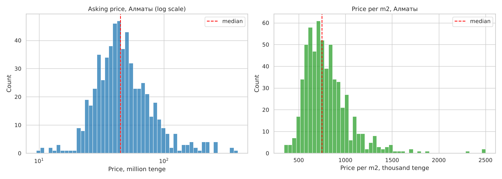
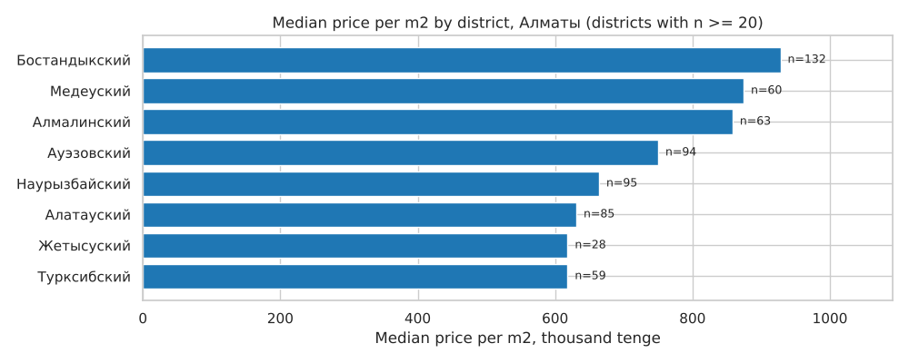
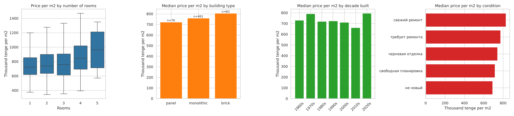
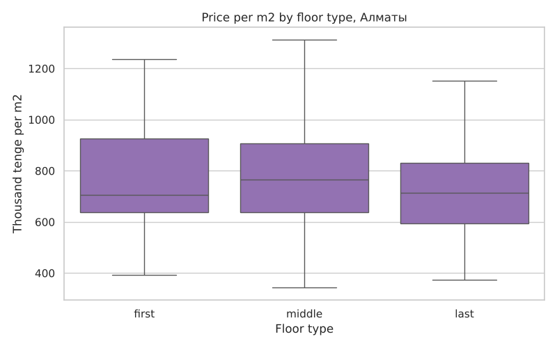
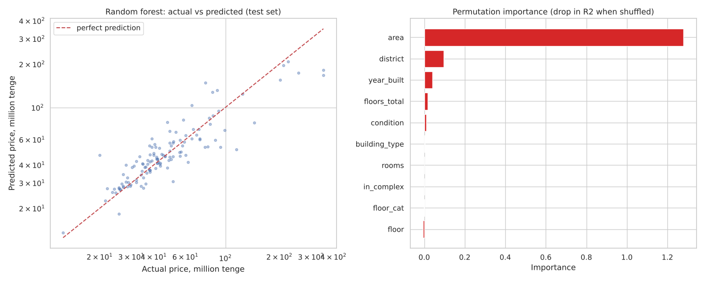

# Анализ рынка недвижимости Казахстана: объявления Krisha.kz (Python)

Сквозной проект по сбору, очистке, разведочному анализу данных (EDA) и моделированию цен на квартиры с платформы [Krisha.kz](https://krisha.kz/).

## Задача
Изучить распределение цен на квартиры в крупных городах Казахстана (на примере **Алматы**), выявить влияние района и параметров жилья (площадь, этажность, год постройки, материал стен) на стоимость квадратного метра и построить модель предсказания цены.

## Что сделано
- сбор и парсинг объявлений с Krisha.kz (`requests` + `BeautifulSoup`) с защитой от блокировок и сохранением в CSV;
- очистка данных и извлечение признаков с помощью регулярных выражений (цена, площадь, комнаты, этаж, этажность дома, год постройки, материал, район);
- фильтрация выбросов ($3 \times \text{IQR}$ по логарифму цены за $\text{м}^2$) и рекламных объявлений застройщиков («от X ₸»);
- исследовательский анализ и проверка гипотезы о скидке на первый и последний этажи (`scipy.stats`);
- обучение и сравнение моделей машинного обучения (**Ridge Regression**, **Random Forest**) с оценкой важности признаков.

## Графики

## Результаты
- медианная цена квартиры в Алматы составляет **45 000 000 ₸** (медианная площадь — **62 м²**, цена за квадратный метр — **750 000 ₸/м²**);
- самые дорогие районы — **Бостандыкский** (`~928 тыс. ₸/м²`) и **Медеуский** (`~875 тыс. ₸/м²`), наиболее доступные — **Турксибский** и **Жетысуский** (`~618 тыс. ₸/м²`);
- квартиры на средних этажах в среднем стоят дороже за $\text{м}^2$, чем на первом и последнем этажах;
- модель **Random Forest** лучше линейной регрессии улавливает нелинейные зависимости (район + площадь + год постройки), однако значительная часть дисперсии цены определяется качеством ремонта и микролокацией, не указанными в карточке объявления.

## Стек
Python, NumPy, pandas, Matplotlib, seaborn, SciPy, scikit-learn, BeautifulSoup4.

## Запуск
.ipynb)
